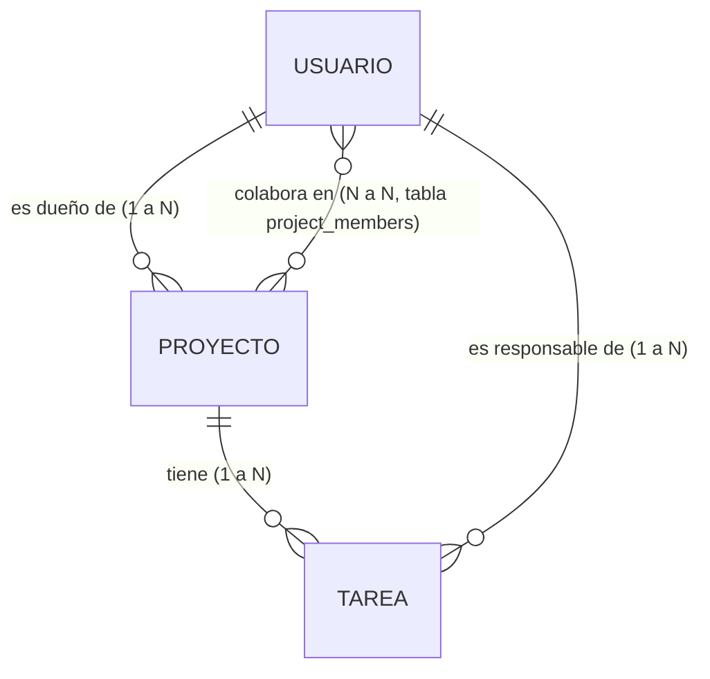

# Gestor de Proyectos — API REST

Trabajo Integrador de **Taller de Nuevas Tecnologías 2** (ORT). Trabajo individual.

API REST en Node.js y Express para gestionar **proyectos**, sus **colaboradores** y las **tareas** de cada proyecto. Tiene arquitectura en capas, persistencia intercambiable (memoria o SQLite con Sequelize), autenticación con JWT, eventos con notificaciones y documentación con Swagger.

## Dominio y entidades

Los usuarios se registran, inician sesión y crean proyectos. El dueño de un proyecto invita colaboradores y reparte tareas entre él y sus colaboradores.

| Entidad      | Datos principales                                                                              |
| ------------ | ---------------------------------------------------------------------------------------------- |
| **Usuario**  | nombre, email (único), contraseña (se guarda con hash), rol (`usuario` o `admin`)              |
| **Proyecto** | título, descripción, fecha de creación, fecha de fin, dueño y colaboradores                    |
| **Tarea**    | título, descripción, estado (`Pendiente`, `En proceso` o `Finalizado`), proyecto y responsable |

### Relaciones



- Un proyecto tiene **un dueño** y **muchos colaboradores**; un usuario puede ser dueño de varios proyectos y colaborar en otros.
- Una tarea pertenece a **un proyecto** y tiene **un responsable**, que debe ser el dueño o un colaborador de ese proyecto.

### Reglas de negocio principales

- El dueño modifica y elimina su proyecto y gestiona los colaboradores. El dueño y los colaboradores ven el proyecto y crean o editan sus tareas; solo el dueño elimina tareas.
- La fecha de fin de un proyecto no puede ser anterior a su fecha de creación.
- El responsable de una tarea debe ser el dueño o un colaborador del proyecto.
- No se elimina un proyecto con tareas, ni se quita a un colaborador con tareas asignadas, ni se elimina a un usuario dueño de proyectos o con tareas asignadas.
- El rol `admin` administra usuarios (listar, crear, modificar, cambiar rol y eliminar); no tiene acceso especial a los proyectos de otros.

## Arquitectura

Capas, de afuera hacia adentro: `routes` → `controllers` → `usecases` → `dao`.

- **routes**: define las rutas y aplica los middlewares (autenticación, autorización y validación con Zod).
- **controllers**: traducen HTTP a llamadas a casos de uso.
- **usecases**: contienen las reglas de negocio. No conocen Express ni la base de datos.
- **dao**: acceso a datos. Cada entidad tiene dos adaptadores con la misma interfaz (memoria y Sequelize) y una _factory_ que elige cuál usar.
- **container**: _Composition Root_. Es el único lugar donde se crean y conectan todas las piezas (inyección de dependencias manual).

```Shell
config/        variables de entorno
connection/    conexión de Sequelize
container/     Composition Root
controllers/   controladores HTTP
dao/           DAOs (memoria y Sequelize), factory y modelos
docs/          documentación de diseño: alcance, decisiones, bitácora y especificaciones
errors/        error de aplicación (AppError)
events/        bus de eventos y nombres de eventos
alerts/        listeners de eventos
notifications/ notificadores (consola, archivo) y su factory
middlewares/   logger, autenticación, validación y manejo de errores
routes/        rutas
schemas/       esquemas de validación (Zod)
security/      hash de contraseñas y tokens JWT
swagger/       publicación de la documentación en /api-docs
usecases/      casos de uso (reglas de negocio)
utils/         reloj inyectable y constantes
openapi.yaml   especificación OpenAPI de la API
requests.http  pruebas manuales (extensión REST Client de VS Code)
checklist.md   autoevaluación de buenas prácticas, con la evidencia de cada ítem
```

## Instalación y ejecución

Requisitos: **Node.js 20.17 o superior**.

```bash
npm install
cp .env.example .env     # en Windows (PowerShell): copy .env.example .env
```

Abrí el archivo `.env` y completá al menos `JWT_SECRET` y `ADMIN_PASSWORD`. Después:

```bash
npm start        # ejecución normal
npm run dev      # reinicia el servidor al guardar cambios
```

El servidor queda en `http://localhost:8000` (o el puerto de `PORT`).

Al arrancar se crea un **administrador inicial** con `ADMIN_EMAIL` y `ADMIN_PASSWORD`. Cualquier otra persona se registra desde la API con el rol `usuario`.

### Scripts

| Comando       | Qué hace                                            |
| ------------- | --------------------------------------------------- |
| `npm start`   | Inicia el servidor                                  |
| `npm run dev` | Inicia el servidor y lo reinicia al guardar cambios |

### Variables de entorno

| Variable                 | Obligatoria | Descripción                                                                                  |
| ------------------------ | ----------- | -------------------------------------------------------------------------------------------- |
| `PORT`                   | no          | Puerto del servidor (por defecto `8000`)                                                     |
| `NODE_ENV`               | no          | Entorno (`development` por defecto)                                                          |
| `PERSISTENCE_TYPE`       | no          | `memory` (por defecto) o `sequelize`                                                         |
| `SQLITE_STORAGE`         | no          | Archivo de la base SQLite (por defecto `database.sqlite`)                                    |
| `JWT_SECRET`             | **sí**      | Secreto para firmar los tokens                                                               |
| `JWT_EXPIRES_IN`         | no          | Duración del token (por defecto `1h`)                                                        |
| `BCRYPT_ROUNDS`          | no          | Rondas del hash de contraseñas (por defecto `10`)                                            |
| `ADMIN_EMAIL`            | **sí**      | Email del administrador inicial                                                              |
| `ADMIN_PASSWORD`         | **sí**      | Contraseña del administrador inicial                                                         |
| `NOTIFIER_TYPE`          | no          | `console` (por defecto), `file` o `both`                                                     |
| `NOTIFICATIONS_LOG_PATH` | no          | Archivo del notificador `file` (por defecto `notifications.log`)                             |
| `DOCS_ENABLED`           | no          | Publica la documentación en `/api-docs`. Por defecto `true`, salvo con `NODE_ENV=production` |
| `CLOCK_NOW`              | no          | Fecha y hora fijas para pruebas (por ejemplo `2026-12-01T12:00:00Z`). Vacío usa la hora real |

Si falta una variable obligatoria, la aplicación no arranca y avisa cuál es.

## Cómo cambiar de persistencia

La persistencia se elige con **una sola variable** en el archivo `.env`, sin tocar el código:

```
PERSISTENCE_TYPE=memory       # datos en memoria: se pierden al reiniciar
PERSISTENCE_TYPE=sequelize    # base SQLite en el archivo database.sqlite
```

Reiniciá el servidor para que tome el cambio. Al arrancar, la consola indica cuál se está usando.

- Con `sequelize`, las tablas se crean solas la primera vez. Si cambia la estructura de una tabla ya existente, borrá `database.sqlite` para que se regenere.
- Los dos modos responden exactamente lo mismo: cada entidad tiene dos DAO con la misma interfaz y la _factory_ `dao/daoFactory.js` decide cuál se usa.

## Documentación de la API

Con el servidor en marcha, la documentación interactiva (OpenAPI 3 con Swagger UI) está en:

**http://localhost:8000/api-docs**

La URL también se muestra en la consola al arrancar. Se puede apagar con `DOCS_ENABLED=false`. Ahí están todos los endpoints con sus parámetros, ejemplos y respuestas posibles (éxito y errores). Para probarlos con **Try it out**:

1. Ejecutá `POST /auth/login` y copiá el `token` de la respuesta.
2. Tocá **Authorize** y pegá el token (sin la palabra `Bearer`).

La especificación vive en el archivo `openapi.yaml`.

## Seguridad

- Las contraseñas se guardan con hash (bcrypt); nunca se devuelven en las respuestas.
- Se inicia sesión con `POST /auth/login` y se obtiene un token JWT que se envía en el header `Authorization: Bearer <token>`.
- El rol nunca se acepta desde el cuerpo de una petición pública: quien se registra siempre es `usuario`.

## Eventos y notificaciones

Los casos de uso emiten **eventos de dominio** en un bus (`EventEmitter`) que crea y inyecta el contenedor. Solo avisan que algo ocurrió, después de guardarlo con éxito; no saben quién escucha ni cómo se notifica.

| Evento                | Cuándo se emite                                     |
| --------------------- | --------------------------------------------------- |
| `task.assigned`       | Al crear una tarea, o al reasignarla a otra persona |
| `project.memberAdded` | Al agregar un colaborador a un proyecto             |

El **listener** (`alerts/registerAlertListeners.js`) escucha esos eventos y arma el mensaje: por ejemplo, `"Diseñar home" (proyecto "Sitio web") fue asignada a Beto <beto@mail.com> por Ana`. Lo envía a través de un **notificador** con la interfaz `notify({ subject, body })`, que se elige con `NOTIFIER_TYPE`: consola, archivo o ambos. Cambiar el canal no requiere tocar las reglas de negocio.

El listener **captura sus propios errores**: si la notificación falla (por ejemplo, un archivo que no se puede escribir), la operación que emitió el evento no se ve afectada y el error queda registrado en la consola.

## Pruebas manuales

El archivo `requests.http` tiene una colección de peticiones para la extensión **REST Client** de VS Code, con los casos de éxito y de error de cada endpoint. Sirve para probar la API en ambos modos de persistencia.

## Limitaciones conocidas

Cosas que **no** resuelve este proyecto, a sabiendas:

- **Los tokens no se revocan.** El JWT no guarda estado: si se elimina un usuario o se le cambia el rol, su token sigue valiendo hasta que venza. Se reduce con un `JWT_EXPIRES_IN` corto.
- **No hay límite de intentos fallidos de login.**
- **Algunas reglas "verificar y después guardar" no son atómicas.** Por ejemplo, si se quita a un colaborador justo mientras se le asigna una tarea, podrían cruzarse los dos pedidos. Lo que sí garantiza la base es que un colaborador no se repita (clave primaria compuesta) y que no se eliminen proyectos ni usuarios con tareas (`ON DELETE RESTRICT`).
- **No hay migraciones.** Las tablas se crean con `sync()`, que no modifica las existentes: si cambia un modelo, hay que borrar `database.sqlite`.
- **El bus de eventos es en memoria y de un solo proceso.** Si el servidor se cae entre guardar y notificar, el aviso se pierde. Las notificaciones no se guardan para consultarlas después.
- **No hay tests automáticos.** Las pruebas son manuales (`requests.http`) y se repiten en los dos modos de persistencia.
- **La documentación está escrita a mano** en `openapi.yaml`: si cambia un endpoint, hay que actualizarla. Se verificó contra las respuestas reales de la API, pero no con un test.
- Las listas de proyectos y tareas consultan los datos de cada colaborador o responsable uno por uno. Con pocos datos no se nota.

## Problemas frecuentes

| Síntoma                                                                       | Causa y solución                                                                                   |
| ----------------------------------------------------------------------------- | -------------------------------------------------------------------------------------------------- |
| `Falta la variable de entorno JWT_SECRET` (o `ADMIN_EMAIL`, `ADMIN_PASSWORD`) | No existe el archivo `.env` o le falta esa variable. Copiá `.env.example` como `.env` y completalo |
| `npm install` falla al instalar `sqlite3`                                     | Verificá que tu versión de Node sea 20.17 o superior (`node -v`)                                   |
| `EADDRINUSE` al arrancar                                                      | El puerto ya está en uso. Cerrá el otro servidor o cambiá `PORT` en `.env`                         |
| `no such table` o `no such column` con Sequelize                              | La base se creó con una estructura anterior. Borrá `database.sqlite` y reiniciá                    |
| `401` con `TOKEN_MISSING`, `TOKEN_INVALID` o `TOKEN_EXPIRED`                  | Hay que iniciar sesión y mandar el token. En Swagger UI, con el botón **Authorize**                |
| `403` en `/users`                                                             | Esos endpoints son solo para el rol `admin`                                                        |
| `/api-docs` da 404                                                            | La documentación está apagada: revisá `DOCS_ENABLED` y que `NODE_ENV` no sea `production`          |
| Los datos desaparecen al reiniciar                                            | Es lo esperado con `PERSISTENCE_TYPE=memory`. Usá `sequelize` para que se guarden                  |

## Documentación de diseño

La carpeta `docs/` reúne el alcance, el diseño, las decisiones tomadas (`decisiones.md`), la bitácora del desarrollo paso a paso y las especificaciones por funcionalidad (`docs/specs/`). El archivo `checklist.md` evalúa el proyecto contra una lista de buenas prácticas, con la evidencia de cada ítem.
