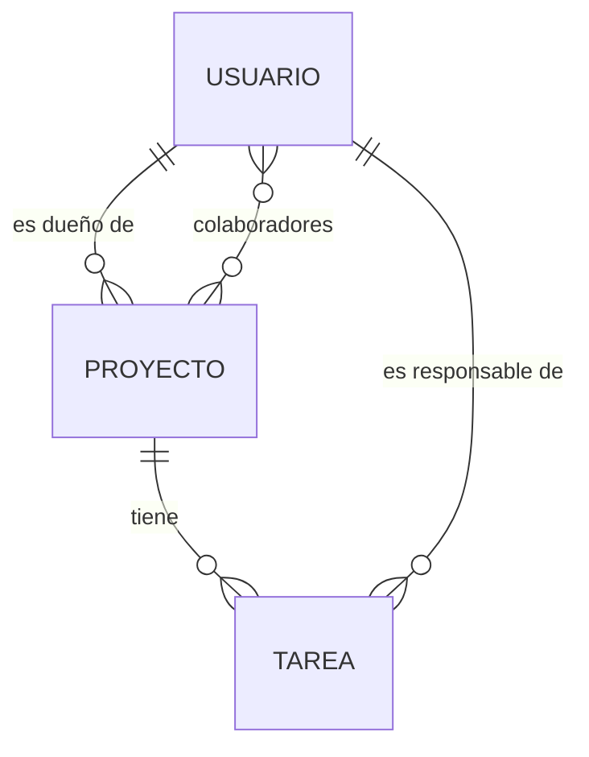

# Diseño

## Entidades

- Usuario: id, nombre, email (único), passwordHash
- Proyecto: id, titulo, descripcion, fechaCreacion, fechaFin, ownerId
- Tarea: id, titulo, descripcion, estado (Pendiente | En proceso | Finalizado), projectId, responsableId
- Miembro de proyecto (tabla intermedia): projectId, userId

## Reglas de negocio

- El responsable de una tarea debe ser el dueño o un colaborador del proyecto (409).
- El email de un usuario no se repite (409).
- fechaFin no puede ser anterior a la fecha de creación (400).
- No se puede agregar al dueño como colaborador ni repetir un colaborador.
- No se puede borrar un proyecto con tareas (409).

## Evento

task.assigned: al asignar una tarea se emite el evento; un listener notifica al responsable.
